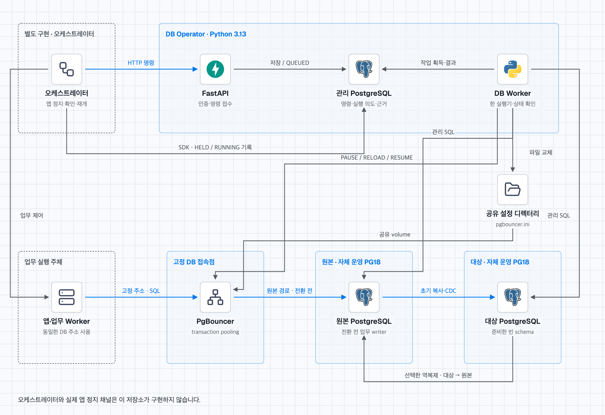

# DB Operator 구현 구조

GCP DMS와 공통 API를 연결했습니다. 복사·CDC·승격과 새 등록 조건은 [DMS API 가이드](dms-api.md)를 따릅니다. 아래 기존 publication·subscription·역복제 설명은 자체 복제 랩 프로필의 구현입니다.

FastAPI는 명령을 DynamoDB에 저장합니다. Python Worker가 저장한 명령을 읽고, PostgreSQL 논리 복제와 PgBouncer를 제어합니다.

[구조·전환·롤백·복구 도식 보기](architecture/index.html)



현재 지원 대상은 자체 운영 PostgreSQL 18과 PgBouncer입니다. RDS·Cloud SQL은 지원하지 않습니다. 전환에는 업무 쓰기 정지 구간이 있습니다.

## 1. 구성 요소

| 코드 | 역할 |
| --- | --- |
| [api.py](../src/db_operator/api.py) | Bearer 인증, 공통 API와 binding 등록·해제 API |
| [service.py](../src/db_operator/service.py) | 지원 조건, revision, 허용 명령, 다음 리소스 진행 조건 검사 |
| [store.py](../src/db_operator/store.py) | 계획·작업·멱등 키·실행 의도·검증 근거를 DynamoDB에 저장 |
| [worker.py](../src/db_operator/worker.py) | 한 실행기만 허용하고 복사·전환·복귀 작업 실행 |
| [postgres.py](../src/db_operator/postgres.py) | PostgreSQL 복제·writer 권한·데이터 검사와 PgBouncer 제어 |
| [config_file.py](../src/db_operator/config_file.py) | 설정 파일 소유자·권한·확장 속성을 보존하고 원자적으로 교체 |
| [control.py](../src/db_operator/control.py) | 오케스트레이터의 HELD·RUNNING 확인 기록 SDK |
| [config.py](../src/db_operator/config.py) | DB·프록시·업무 범위, 승인 목록 SDK, Secret 참조 조회 |
| [runtime.py](../src/db_operator/runtime.py) | ECS 설정, PgBouncer 시작·복원, API·Worker 실행 |
| [dms.py](../src/db_operator/dms.py) | DMS SDK 호출·실행 기록·연결 검사와 복제 시작 명령 |

구현은 Python 파일 13개로 묶었습니다. 진행 조건은 service.py, 명령별 실행과 복구는 worker.py에서 읽습니다.
DB 관측·스키마·복제·PgBouncer 제어는 postgres.py, 상태와 프록시 경로 저장은 store.py에 있습니다.
기존 HTTP 계약과 실행 명령은 유지합니다.

ECS는 Task 하나에 컨테이너 두 개를 실행합니다. backend 컨테이너가 API·Worker 프로세스를 함께 실행하고, PgBouncer는 별도 컨테이너로 실행합니다. backend 실행기가 종료 신호를 전달하고 자식 프로세스를 회수합니다. 하나가 예상치 않게 종료되면 나머지도 정리하고 컨테이너를 종료합니다.

앱은 같은 PgBouncer 주소를 계속 사용합니다. Worker가 PgBouncer의 연결 대상을 바꿉니다. 앱에 새 DB 주소를 전달하는 방식은 아닙니다.

Worker는 PgBouncer 설정 디렉터리를 공유해야 합니다. 등록한 alias의 host·port·dbname만 바꾸고 파일을 원자적으로 교체한 뒤 RELOAD합니다. 다른 옵션·주석·%include는 유지합니다. config_path는 alias가 직접 정의된 파일이어야 합니다. include 파일에 alias가 있으면 그 파일을 등록합니다. API에 원격 호스트 정보만 전달한다고 배포까지 처리하지는 않습니다.

## 2. 요청 접수와 실제 실행

1. 오케스트레이터가 등록한 리소스 참조로 이전 계획을 만듭니다.
2. 각 명령에 최신 expectedRevision과 Idempotency-Key를 전달합니다.
3. API는 한 트랜잭션에서 상태 검사, QUEUED 작업 저장, 멱등 응답 저장을 수행합니다.
4. Worker가 DynamoDB 잠금을 확보하고 작업을 획득합니다.
5. 외부 변경 전에 실행 의도를 먼저 저장합니다. 외부 변경 뒤에는 실제 상태와 결과를 저장합니다.
6. 오케스트레이터는 operationId로 완료 여부를 조회합니다. HTTP 202는 접수 성공입니다.

같은 키·본문은 최초 작업을 반환합니다. 같은 키에 다른 본문을 보내면 거절합니다. 미등록 호스트·SQL·셸 명령은 API로 받지 않습니다.

GET은 기본 2초 동안 관측 결과를 재사용합니다. 캐시 조회는 DynamoDB 항목을 읽으며 잠금을 만들지 않습니다. 새 관측을 반영할 때는 읽기 시작 시점의 revision과 명령 실행 여부를 다시 검사합니다. Worker가 상태를 바꿨으면 오래된 관측을 버립니다.

캐시가 만료된 조회가 겹치면 같은 API 프로세스에서 관측을 한 번만 수행합니다. 나머지 조회는 갱신이 끝난 뒤 캐시를 다시 확인합니다. 유효한 캐시 조회는 이 대기를 거치지 않습니다. 외부 변경을 막는 DynamoDB 실행기 잠금과는 별도 처리입니다.

## DynamoDB 저장 계약

상태는 업무 DB와 분리한 테이블에 저장합니다. API·Worker·PgBouncer는 같은 테이블·namespace를 사용합니다.

| 키 | 역할 |
|---|---|
| `namespace` | 서버 설정으로 정한 PgBouncer 관리 영역. 사용자 요청에서 받지 않음 |
| `record` | `MIG#`, `OP#`, `IDEMP#`, `CLAIM#`, `WORKFLOW#`, `ROUTE#`, `LOCK#` 등 기록 종류와 ID |
| `<namespace>:control` | 오케스트레이터가 확인한 `GATE#`, `WORKLOAD#`, `SCOPE_GATE#` 기록 |
| `QUEUE#`, `RUNNING#` | 대기·실행 중 명령을 조회하는 기본 테이블 항목. GSI·Scan을 사용하지 않음 |
| `SCOPE_MIG#`, `BINDING_MIG#`, `MIG_CLAIM#` | 업무 범위·binding·리소스 점유의 조회 항목 |
| `DMS_OP#`, `DMS_KEY#`, `DMS_ACTIVE#`, `DMS_VERIFIED#` | DMS 명령·멱등 키·미확인 실행·연결 검사 기록 |
| `EPOCH` | 여러 상태 항목과 Query 결과의 추가·삭제 경합을 감지하는 관리 revision |

`GetItem`과 기본 테이블 `Query`는 강한 일관성으로 읽습니다. 변경은 읽기 시작 시점의 EPOCH와 실행기 소유자를 조건으로 검사하고, 한 `TransactWriteItems`에서 함께 반영합니다. 경합하면 외부 변경이 없는 상태 계산만 최대 8회 다시 수행합니다. 외부 DB 변경은 이 재시도에 포함하지 않습니다.

한 namespace는 PgBouncer 하나의 관리 영역입니다. 이 프록시를 공유하는 여러 앱은 같은 namespace를 사용합니다. 다른 namespace가 같은 프록시를 제어하는 구성은 지원하지 않습니다. 직렬화하는 EPOCH는 업무 SQL 경로에 없으며, 대규모 관리 부하는 별도 측정이 필요합니다. 원본·대상 데이터나 Secret 값은 DynamoDB에 저장하지 않습니다. 동적 등록·해제와 binding별 설정은 [앱 등록 가이드](bindings.md)를 따릅니다.

Worker는 자동 만료하지 않는 소유자 잠금을 사용합니다. 외부 변경 전에는 소유권을 읽고, 상태 변경 트랜잭션에도 소유자 조건을 넣습니다. 강제 종료된 Worker의 잠금은 시간 경과만으로 인계하지 않습니다. 운영자가 이전 실행기 종료와 DB 세션을 확인한 뒤 `recover-lock`으로 해제하고 RECONCILE합니다. 종료 근거는 감사 기록에 남깁니다. CLI는 운영자가 제공한 종료 근거 자체를 AWS와 자동 대조하지 않습니다.

DynamoDB가 응답하지 않으면 새 외부 변경을 실행하지 않습니다. 기존에 실행 중인 SQL 명령의 중단까지 보장하는 것은 아닙니다. 결과가 불명인 작업은 재전송하지 않고 복구 대상으로 남깁니다. 정상 동작 중인 PgBouncer는 매 SQL 요청마다 DynamoDB를 조회하지 않습니다.

진행 중 상태·잠금·경로에는 TTL을 설정하지 않습니다. 항목과 트랜잭션 크기 상한을 넘기면 부분 반영 없이 거절합니다. 기본 배포 템플릿은 온디맨드, PITR, 삭제 방지를 사용합니다. 실제 IAM 권한과 ECS 배포는 클라우드에서 별도 검증해야 합니다.

## 3. 정방향 전환

| 단계 | 실제 처리와 완료 조건 |
| --- | --- |
| PREPARE | PostgreSQL 18·logical WAL·권한·schema·등록 범위 검사. 대상 업무 table은 비어 있고 대상 writer는 NOLOGIN이어야 함 |
| START_SYNC | 원본 publication과 대상 subscription 생성. copy_data=true로 초기 복사 후 CDC 수행 |
| READY 확인 | 상태 조회로 초기 복제 준비를 확인. START_SYNC 명령 성공과 초기 복사 완료는 별개 |
| 앱 정지 | 오케스트레이터가 앱·업무 Worker·예약 작업을 정지. 모든 등록 주체의 HELD와 inFlight=0을 확인해 quiesceRef 저장 |
| QUIESCE | 근거 검사 → PgBouncer PAUSE → 업무 writer NOLOGIN → 기존 세션 0 확인 → 최종 barrier 적용·내구성 확인 → 복제 정지 → sequence 동기화·전체 데이터 digest 대조 |
| CUTOVER | REVERSE_REQUIRED 모드라면 대상 쓰기 전에 역복제 준비. 사용이 끝난 정방향 publication·slot 정리. PgBouncer 설정을 대상으로 변경·RELOAD. PAUSE와 writer 차단은 유지 |
| RESUME TARGET | 대상 쓰기 가능성을 DynamoDB에 먼저 기록. 대상 writer LOGIN·PgBouncer RESUME 후 실제 앱 접속점의 DB·서버·계정 확인 |
| 앱 재개 | 오케스트레이터가 실제 업무를 재개하고 업무 검사·RUNNING 근거 기록 |
| 다음 리소스 | 상태·경로·업무 검사·후속 복제·30초 안정 구간을 확인. 관측 간격은 10초 이하. readiness.advance=PASS여야 진행 |
| FINALIZE | 보존 기간과 진행 조건 확인 후 이 계획의 publication·subscription·slot 정리. 원본 DB·업무 table·데이터는 삭제하지 않음 |

권한·경로가 바뀌면 topologyRevision도 바뀝니다. QUIESCE·CUTOVER·RESUME 사이에서 최신 HELD 근거를 다시 발급합니다. 같은 정지가 이어지면 generation과 최초 held_since는 유지합니다. 근거가 만료돼도 업무를 자동 재개하지 않습니다.

barrier 검사에는 첫 marker의 커밋 이후 WAL 경계를 저장합니다. 뒤이어 두 번째 marker를 커밋해 복제가 그 경계를 통과하게 합니다. 대상에서 두 번째 marker를 읽고, pg_replication_origin_progress(origin, true)가 저장한 경계 이상인지 확인합니다. NULL이 아니라는 이유만으로 통과시키지 않습니다.

## 4. 롤백

**대상 쓰기 전:** 원본이 기준 DB입니다. writer 차단을 확인하고 원본 schema·데이터를 검사합니다. ROLLBACK으로 원본 경로를 복구합니다. 별도 RESUME SOURCE 후 오케스트레이터가 업무를 재개합니다. 불완전한 미사용 대상 복사가 직접 복귀를 막지는 않습니다.

이 조건에서는 대상 DB가 응답하지 않아도 명시적 ROLLBACK을 요청할 수 있습니다. PREPARE에서 확인한 대상 writer 차단, 대상 쓰기 허용 의도가 없다는 영속 기록, 현재 원본·PgBouncer·업무 정지 근거가 모두 필요합니다. 원본에서 이 계획의 정방향 publication·slot을 정리하고 원본만 검증합니다. 대상의 현재 상태를 직접 확인한 결과와 저장한 차단 근거를 내부 기록의 accessEvidence로 구분합니다. 대상이 다시 연결돼야 FINALIZE할 수 있습니다.

**대상 쓰기 후:** REVERSE_REQUIRED 모드에서 미리 준비한 역복제가 필요합니다. 같은 transitionId로 업무를 다시 정지하고 generation을 증가시킵니다. QUIESCE가 대상 → 원본 최종 barrier·데이터·sequence를 검증합니다. 그다음 ROLLBACK → 최신 정지 근거 → RESUME SOURCE 순서로 복귀합니다.

BEFORE_TARGET_WRITE 모드에서 대상 쓰기를 열었다면 빠른 원본 복귀를 지원하지 않습니다. 역복제·최신성 근거가 부족하면 중단합니다. 자동 원본 복귀는 하지 않습니다.

## 5. 실패 후 복구

| 상황 | 처리 |
| --- | --- |
| GET 관측 실패 | 마지막 명령 결과를 UNKNOWN으로 바꾸지 않음. 진행 조건만 UNKNOWN으로 두고 다음 GET에서 다시 관측. 실제 명령의 UNKNOWN은 자동으로 해제하지 않음 |
| 외부 변경 전 실패 | FAILED 기록. 실제 상태 대조 후 다음 명령 결정 |
| 외부 실행 의도 저장 후 실패·응답 유실 | UNKNOWN 기록. 대상 쓰기 가능성과 기존 실행 기록 보존. 다른 변경 차단 |
| Worker 재시작 | 중단한 RUNNING 작업을 자동 재실행하지 않음. 실행 의도에 따라 FAILED 또는 UNKNOWN 처리 |
| RECONCILE | 이전 원격 연결 종료, 실제 경로·권한·PAUSE·저장 근거 대조. 외부 자원은 변경하지 않음 |
| 실제 상태가 여전히 불명 | 계속 중단. allowedActions와 최신 상태를 확인하기 전에는 전환·재개·복귀하지 않음 |

Worker는 외부 변경 전마다 DynamoDB 잠금을 확인합니다. 관측할 수 있는 이전 원격 관리 연결이 idle이어도 남아 있으면 복구 완료 판정을 막습니다. 대상 쓰기 전 직접 복귀 중에는 대상의 저장된 차단 근거를 사용하며 원본 연결은 계속 검사합니다. 과거 UNKNOWN 작업의 결과를 성공으로 덮어쓰지 않고 별도 RECONCILE 작업을 남깁니다. 명령 성공 뒤 관측이 실패해도 성공 기록을 유지하고 Worker는 다음 작업을 처리합니다.

## 6. 현재 한계

- 자체 운영 PostgreSQL 18의 제한된 프로필입니다. 관리 SQL에 superuser가 필요합니다. RDS·Cloud SQL 권한 모델은 구현하지 않았습니다.
- 같은 schema, PK와 DEFAULT replica identity가 있는 일반 table, 등록한 모든 table·sequence·업무 주체가 필요합니다. DDL·RLS·partition·사용자 trigger·large object·2PC는 지원하지 않습니다.
- 인프라 생성, 앱의 실제 정지·재개 채널, Secret 배포, 네트워크 구성은 별도 구현입니다.
- 전체 데이터 digest 대조 시간은 DB 크기에 따라 늘어납니다. 큰 DB의 쓰기 정지 시간·WAL 보관량·부하와 고가용성은 검증하지 않았습니다.

검사 환경과 결과는 [검증 기록](verification.md)에 있습니다. 이전 장애 수정 내역은 [장애 경로 검토와 수정](review-fixes.md)에 있습니다. 실제 클라우드 운영 검증은 별도로 수행해야 합니다.

## 도식 다시 만들기

도식은 [caru-ini/stack-diagram](https://github.com/caru-ini/stack-diagram)의 템플릿·빌더로 만들었습니다. 도구와 아이콘 디렉터리를 준비한 뒤 실행합니다. 아이콘 출처와 도구 버전은 [architecture](architecture/)에 기록했습니다.

본문·스타일 원본은 docs/architecture-source에 있고, 노드·연결·좌표는 scripts/build_architecture.py에서 정의합니다. 출력 HTML을 직접 수정하면 다음 생성에서 덮어씁니다.

```sh
python scripts/build_architecture.py --skill-dir /path/to/skills/stack-diagram --icon-dir /path/to/icons
```

밝은·어두운 PNG는 생성한 HTML을 Chromium으로 표시해 저장합니다. 같은 HTML의 #architecture·#cutover·#rollback·#recovery를 각각 캡처합니다. HTML에는 폰트와 아이콘이 포함되므로 문서를 읽을 때 네트워크가 필요하지 않습니다.

```sh
python /path/to/skills/stack-diagram/scripts/render_png.py docs/architecture/index.html docs/architecture/architecture.png --selector '#architecture' --scale 2
```

cutover·rollback·recovery도 같은 명령에서 파일 이름과 selector를 바꿔 생성합니다. 기본 명령은 두 화면 테마를 모두 저장합니다.


## 두 번째 검토에서 보강한 조건

PREPARE는 UNIQUE INDEX 정의와 sequence 전체 설정을 비교해 버전 2의 schema 기준값을 저장합니다. START_SYNC·전환·복귀 전에 이 기준값을 재검사합니다. 이전 형식의 기준값은 새 검사에 통과하지 않습니다. 진행 중 계획의 기준값을 임의로 바꾸지 말고, 원본 복귀·정리 후 새 계획을 만듭니다.

제어 기록 변경과 명령 접수는 같은 namespace revision을 조건으로 검사합니다. 업무 상태 변경은 같은 scope의 이전 진행 PASS·캐시·안정화 구간을 무효화합니다. FINALIZE는 같은 조건부 트랜잭션에서 최신 근거를 확인하고, 승인 위치와 외부 삭제 의도를 함께 기록한 뒤 복제 객체를 정리합니다.

부분 재개는 resumePending에 재개 위치를 기록합니다. 실제 경로·writer 권한·세션·기존 실행기 종료와 영속 재개 의도가 맞아야 합니다. RECONCILE은 경로를 바꾸거나 쓰기를 열지 않습니다. 오케스트레이터가 최신 정지 근거를 발급하고 명시적 RESUME을 요청해야 합니다.
